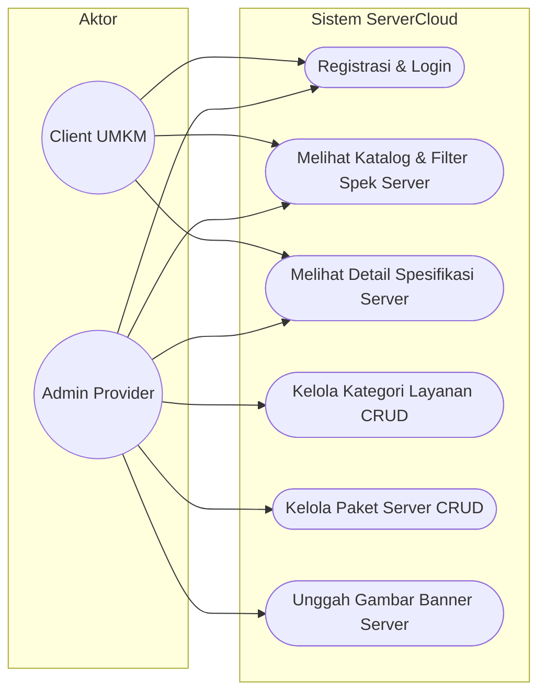
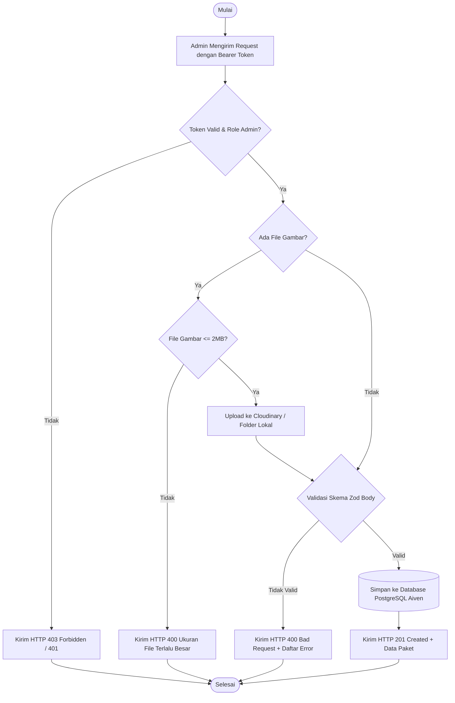
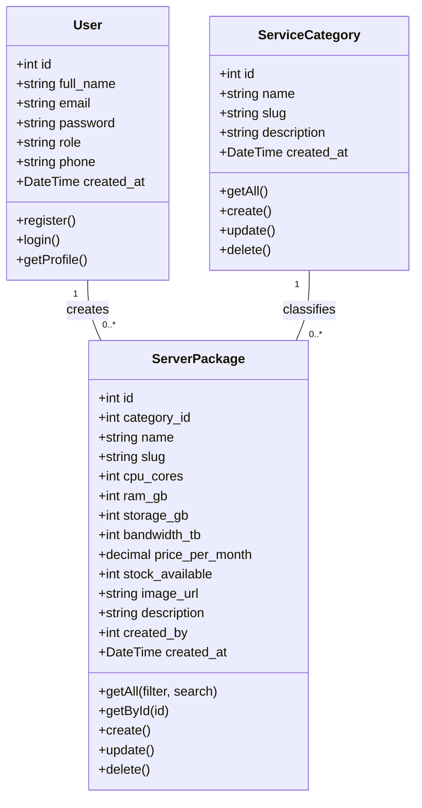
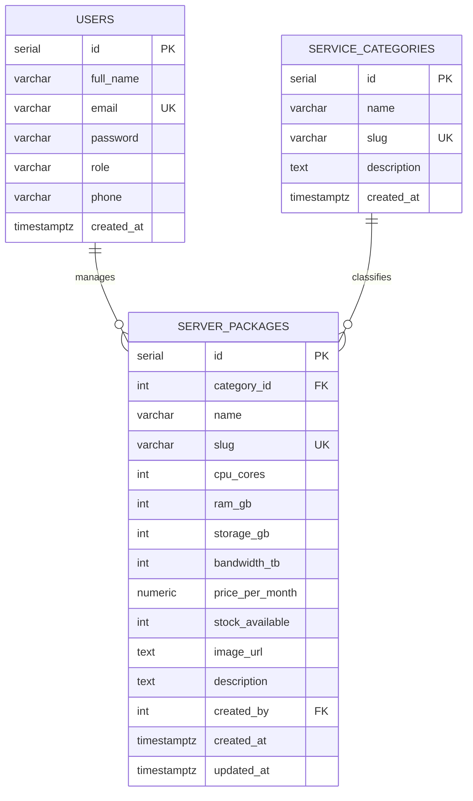

# DOKUMEN SOFTWARE REQUIREMENTS SPECIFICATION (SRS)
## SISTEM LAYANAN CLOUD HOSTING & VPS MANDIRI UNTUK UMKM (SERVERCLOUD)

**Disusun Oleh:**  
Nama: Rafi Arrasyid  
NISN: 0095484729  
Kelas: XI RPL 3  
Kompetensi Keahlian: Rekayasa Perangkat Lunak  
Satuan Pendidikan: SMK Taruna Bhakti  
Tahun Pelajaran: 2026/2027  

---

## DAFTAR ISI
- [BAB I PENDAHULUAN](#bab-i-pendahuluan)
  - [1.1 Latar Belakang](#11-latar-belakang)
  - [1.2 Rumusan Masalah](#12-rumusan-masalah)
  - [1.3 Tujuan Penulisan Dokumen](#13-tujuan-penulisan-dokumen)
- [BAB II METODE PENGEMBANGAN SISTEM](#bab-ii-metode-pengembangan-sistem)
  - [2.1 Metode Pengembangan (SDLC Waterfall)](#21-metode-pengembangan-sdlc-waterfall)
  - [2.2 Jadwal Pengembangan Sistem (Timeline & Gantt Chart)](#22-jadwal-pengembangan-sistem-timeline--gantt-chart)
- [BAB III ANALISIS KEBUTUHAN SISTEM](#bab-iii-analisis-kebutuhan-sistem)
  - [3.1 Nama Sistem](#31-nama-sistem)
  - [3.2 Ruang Lingkup](#32-ruang-lingkup)
  - [3.3 Kebutuhan Fungsional (Functional Requirements)](#33-kebutuhan-fungsional-functional-requirements)
  - [3.4 Kebutuhan Non-Fungsional (Non-Functional Requirements)](#34-kebutuhan-non-fungsional-non-functional-requirements)
  - [3.5 Batasan Sistem (System Constraints)](#35-batasan-sistem-system-constraints)
- [BAB IV DEVELOPMENT](#bab-iv-development)
  - [4.1 Desain Sistem (Use Case, Activity, & Class Diagram)](#41-desain-sistem)
  - [4.2 Perancangan Database (ERD & Table Schema)](#42-perancangan-database)
  - [4.3 Struktur Project](#43-struktur-project)
  - [4.4 Quality Assurance (Blackbox Testing)](#44-quality-assurance-blackbox-testing)
  - [4.5 Deployment](#45-deployment)
- [BAB V PENUTUP](#bab-v-penutup)
  - [5.1 Kesimpulan](#51-kesimpulan)
  - [5.2 Lampiran](#52-lampiran)

---

# BAB I PENDAHULUAN

### 1.1 Latar Belakang
Di era transformasi digital saat ini, Usaha Mikro, Kecil, dan Menengah (UMKM) dituntut untuk memiliki kehadiran daring (*online presence*) yang andal, mulai dari website profil, platform toko online, hingga aplikasi operasional berbasis web. Namun, sebagian besar UMKM di Indonesia menghadapi kendala tingginya biaya berlangganan infrastruktur cloud internasional (seperti AWS, Azure, atau Google Cloud) yang menggunakan mata uang asing serta skema penagihan yang rumit.

Untuk menjawab tantangan tersebut, muncul pelaku UMKM di sektor Jasa Teknologi Informasi yang menyediakan layanan *Reseller Cloud Hosting, Virtual Private Server (VPS), dan Dedicated Server* berskala lokal dengan harga terjangkau dalam mata uang Rupiah. Guna mendukung operasional penyedia jasa infrastruktur digital ini, dibutuhkan sebuah platform aplikasi terintegrasi (**ServerCloud**) yang memudahkan pengelolaan paket server, pemantauan kapasitas resource hardware (vCPU, RAM, Storage NVMe, Bandwidth), dan penyajian katalog spesifikasi server yang transparan bagi pelanggan.

### 1.2 Rumusan Masalah
1. Bagaimana merancang arsitektur sistem informasi katalog dan manajemen layanan cloud/VPS yang terstruktur dan aman untuk UMKM?
2. Bagaimana membangun REST API berbasis Node.js Express dan TypeScript dengan validasi input yang kuat menggunakan Zod serta otorisasi berbasis peran (Role-Based Access Control)?
3. Bagaimana mengelola penyimpanan basis data relasional di cloud Aiven PostgreSQL serta mengintegrasikan penyimpanan file banner/arsitektur menggunakan Cloudinary?
4. Bagaimana merancang aplikasi antarmuka client (Flutter) yang responsif dan memudahkan pelanggan dalam menjelajahi spesifikasi teknis server?

### 1.3 Tujuan Penulisan Dokumen
Dokumen *Software Requirements Specification* (SRS) ini disusun dengan tujuan:
1. Mendefinisikan kebutuhan fungsional dan non-fungsional dari sistem ServerCloud secara rinci.
2. Menjadi acuan teknis dalam tahap perancangan arsitektur, pemodelan data (ERD), diagram UML, dan implementasi kode sumber.
3. Menjadi panduan pengujian mutu perangkat lunak (*Quality Assurance*) menggunakan metode Blackbox Testing.
4. Memenuhi syarat kelengkapan penilaian Uji Level Kompetensi Keahlian Rekayasa Perangkat Lunak SMK Taruna Bhakti TP 2026/2027.

---

# BAB II METODE PENGEMBANGAN SISTEM

### 2.1 Metode Pengembangan (SDLC Waterfall)
Pengembangan sistem ServerCloud mengadopsi model **SDLC Waterfall (Air Terjun)**. Model ini dipilih karena:
* Kebutuhan fungsional dan kriteria penilaian ujian telah terdefinisi secara jelas sejak awal.
* Memiliki tahapan yang teratur, sistematis, dan mudah dipantau:
  1. **Requirement Analysis**: Menganalisis kebutuhan pengguna, entitas data, dan batasan teknis.
  2. **System & Software Design**: Merancang ERD, Use Case, Activity Diagram, dan spesifikasi REST API.
  3. **Implementation / Coding**: Mengimplementasikan Backend REST API (Node.js/TS), Database (Aiven PostgreSQL), dan Client Frontend (Flutter).
  4. **Testing / Verification**: Menjalankan pengujian otomatis dan blackbox testing pada setiap endpoint.
  5. **Deployment & Maintenance**: Melakukan deployment basis data ke Aiven dan backend ke server produksi/cloud.

### 2.2 Jadwal Pengembangan Sistem (Timeline & Gantt Chart)

| No | Aktivitas / Tahapan | Jam 1 | Jam 2 | Jam 3 | Jam 4 | Jam 5 | Jam 6 | Jam 7 | Jam 8 |
| :---: | :--- | :---: | :---: | :---: | :---: | :---: | :---: | :---: | :---: |
| 1 | Analisis Kebutuhan & Penyusunan Dokumen SRS | ████ |  |  |  |  |  |  |  |
| 2 | Perancangan ERD, Skema Database, & DDL PostgreSQL |  | ████ |  |  |  |  |  |  |
| 3 | Setup Database Cloud Aiven & Eksekusi Migrasi Data |  | ████ |  |  |  |  |  |  |
| 4 | Pembuatan Backend REST API (Express, TS, Zod, JWT) |  |  | ████ | ████ |  |  |  |  |
| 5 | Integrasi Upload Banner Server (Multer & Cloudinary) |  |  |  | ████ |  |  |  |  |
| 6 | Pembuatan UI Client Flutter & State Management |  |  |  |  | ████ | ████ |  |  |
| 7 | Integrasi API Client Flutter dengan Backend |  |  |  |  |  | ████ | ████ |  |
| 8 | Pengujian Sistem (Blackbox Testing) & Deployment |  |  |  |  |  |  |  | ████ |

---

# BAB III ANALISIS KEBUTUHAN SISTEM

### 3.1 Nama Sistem
**ServerCloud** — *Platform Layanan Cloud Hosting, Virtual Private Server (VPS), dan Dedicated Server Mandiri untuk UMKM*.

### 3.2 Ruang Lingkup
* **Deskripsi Sistem**: Sistem perangkat lunak terintegrasi yang terdiri dari Backend REST API dan antarmuka client mobile/web untuk memfasilitasi publikasi, pengelolaan, dan pemesanan layanan infrastruktur server.
* **Manfaat Sistem**:
  - **Bagi Administrator (Penyedia Jasa)**: Mempermudah katalogisasi paket server, pembaharuan stok hardware instance, pengelolaan kategori layanan, dan keamanan hak akses multi-role.
  - **Bagi Client (Pelanggan UMKM)**: Memudahkan perbandingan spesifikasi teknis komputer server (vCPU, RAM, NVMe SSD, Bandwidth) secara transparan dengan harga pasti per bulan.

### 3.3 Kebutuhan Fungsional (Functional Requirements)
1. **Modul Autentikasi & Akun**:
   - `FR-01`: Pengguna dapat mendaftarkan akun baru dengan validasi format email, nomor telepon, dan password minimal 6 karakter.
   - `FR-02`: Pengguna dapat melakukan login dan memperoleh token otentikasi JWT (JSON Web Token) dengan masa aktif 24 jam.
   - `FR-03`: Sistem mengenkripsi kata sandi menggunakan algoritma *hashing* `bcrypt` sebelum disimpan ke basis data.
   - `FR-04`: Sistem menerapkan pembagian hak akses (*Role-Based Access Control*): role **Admin** dan role **Client**.
2. **Modul Kategori Layanan (Data Utama 1)**:
   - `FR-05`: Pengguna (Admin & Client) dapat melihat daftar kategori layanan cloud (Cloud VPS, Shared Hosting, Dedicated Server).
   - `FR-06`: Admin dapat menambahkan kategori layanan baru dengan validasi nama unik dan slug otomatis.
   - `FR-07`: Admin dapat memperbarui nama dan deskripsi kategori layanan.
   - `FR-08`: Admin dapat menghapus kategori layanan (dilindungi proteksi integritas: kategori tidak dapat dihapus jika masih menampung paket server aktif).
3. **Modul Paket Layanan Cloud / Server (Data Utama 2)**:
   - `FR-09`: Pengguna dapat melihat daftar seluruh paket server dengan informasi spesifikasi lengkap.
   - `FR-10`: Pengguna dapat memfilter paket server berdasarkan kategori, mencari kata kunci nama, atau mengurutkan harga termurah/termahal.
   - `FR-11`: Pengguna dapat melihat detail spesifik satu paket server beserta rincian kategori dan pembuatnya.
   - `FR-12`: Admin dapat membuat paket server baru dengan spesifikasi teknis (vCPU, RAM GB, Storage GB, Bandwidth TB, Harga/Bulan, Stok).
   - `FR-13`: Admin dapat mengunggah file gambar banner/diagram arsitektur server (format JPG/PNG/WEBP, ukuran maks 2MB) yang terhubung ke Cloudinary atau penyimpanan lokal.
   - `FR-14`: Admin dapat memperbarui data spesifikasi dan mengganti foto banner paket server.
   - `FR-15`: Admin dapat menghapus paket server dari katalog.

### 3.4 Kebutuhan Non-Fungsional (Non-Functional Requirements)
* **Kebutuhan Produk (Product Requirements)**:
  - *Performance*: Waktu respon REST API rata-rata di bawah 300 ms untuk query standar.
  - *Security*: Seluruh endpoint privat wajib menyertakan Authorization Bearer Token. Password disimpan dalam format satu arah (*one-way hash*). Proteksi SQL Injection menggunakan parameterized queries.
  - *Usability*: Format respon API konsisten berupa JSON `{ success, message, data, errors }`.
* **Kebutuhan Organisasi**:
  - Kode sumber ditulis dalam bahasa TypeScript yang rapi, modular, dan memisahkan lapisan Controller, Service/Config, Route, dan Validator.
  - Version control menggunakan Git dan GitHub dengan percabangan (*branching strategy*).
* **Kebutuhan Eksternal**:
  - Mengikuti regulasi privasi data dengan tidak menampilkan kata sandi pada respon API profil.
  - Menggunakan layanan basis data bersertifikasi cloud (Aiven PostgreSQL SSL).

### 3.5 Batasan Sistem (System Constraints)
* Backend dibangun menggunakan Node.js (v20+) dan Express.js.
* Database manajemen wajib menggunakan PostgreSQL relasional.
* Validasi payload request body dibatasi oleh skema Zod.
* Batas ukuran unggahan gambar dibatasi maksimal 2 Megabyte.

---

# BAB IV DEVELOPMENT

### 4.1 Desain Sistem

#### A. Use Case Diagram


#### B. Activity Diagram: Tambah Paket Server (Admin)


#### C. Class Diagram


---

### 4.2 Perancangan Database

#### A. Entity Relationship Diagram (ERD)


#### B. Table Schema
1. **Tabel `users`**:
   - `id` (SERIAL, Primary Key)
   - `full_name` (VARCHAR(100), NOT NULL)
   - `email` (VARCHAR(100), UNIQUE, NOT NULL)
   - `password` (VARCHAR(255), NOT NULL)
   - `role` (VARCHAR(20), CHECK role IN ('admin', 'client'), NOT NULL)
   - `phone` (VARCHAR(30))
   - `created_at` (TIMESTAMPTZ, DEFAULT CURRENT_TIMESTAMP)
2. **Tabel `service_categories`**:
   - `id` (SERIAL, Primary Key)
   - `name` (VARCHAR(100), NOT NULL)
   - `slug` (VARCHAR(100), UNIQUE, NOT NULL)
   - `description` (TEXT)
   - `created_at` (TIMESTAMPTZ, DEFAULT CURRENT_TIMESTAMP)
3. **Tabel `server_packages`**:
   - `id` (SERIAL, Primary Key)
   - `category_id` (INT, FK ke `service_categories.id` ON DELETE RESTRICT ON UPDATE CASCADE)
   - `name` (VARCHAR(150), NOT NULL)
   - `slug` (VARCHAR(150), UNIQUE, NOT NULL)
   - `cpu_cores` (INT, CHECK cpu_cores >= 1)
   - `ram_gb` (INT, CHECK ram_gb >= 1)
   - `storage_gb` (INT, CHECK storage_gb >= 1)
   - `bandwidth_tb` (INT, CHECK bandwidth_tb >= 1)
   - `price_per_month` (NUMERIC(14,2), CHECK price_per_month >= 0)
   - `stock_available` (INT, DEFAULT 10)
   - `image_url` (TEXT)
   - `description` (TEXT)
   - `created_by` (INT, FK ke `users.id` ON DELETE SET NULL)
   - `created_at` (TIMESTAMPTZ)
   - `updated_at` (TIMESTAMPTZ)

---

### 4.3 Struktur Project
```
c:\Tb\koke 2\Tugas ass\
├── backend/
│   ├── database/
│   │   ├── schema.sql               # File DDL pembuatan tabel
│   │   ├── seed.sql                 # File DML data awal & akun uji
│   │   └── migrate.ts               # Runner migrasi database
│   ├── src/
│   │   ├── config/
│   │   │   ├── db.ts                # Pool koneksi PostgreSQL Aiven (SSL)
│   │   │   └── cloudinary.ts        # Inisialisasi Cloudinary SDK
│   │   ├── controllers/
│   │   │   ├── authController.ts    # Kontroler Auth (Register, Login, Me)
│   │   │   ├── categoryController.ts# Kontroler CRUD Kategori
│   │   │   └── packageController.ts # Kontroler CRUD Paket Server + Upload
│   │   ├── middlewares/
│   │   │   ├── auth.ts              # Guard verifikasi JWT & Role
│   │   │   ├── validate.ts          # Middleware pemvalidasi Zod
│   │   │   ├── upload.ts            # Multer config (2MB limit, MIME image)
│   │   │   └── errorHandler.ts      # Global & 404 handler
│   │   ├── routes/
│   │   │   ├── authRoutes.ts
│   │   │   ├── categoryRoutes.ts
│   │   │   └── packageRoutes.ts
│   │   ├── validators/              # Skema Zod
│   │   │   ├── authValidator.ts
│   │   │   ├── categoryValidator.ts
│   │   │   └── packageValidator.ts
│   │   ├── app.ts                   # Inisialisasi express
│   │   └── server.ts                # Listener port & runner
│   ├── scripts/
│   │   └── test-api.ts              # Automation testing suite
│   ├── api-test.http                # VS Code REST client collection
│   ├── package.json
│   └── tsconfig.json
└── docs/
    ├── SRS_ServerCloud.md           # Dokumen SRS lengkap
    ├── ERD.md                       # Dokumentasi Basis Data
    └── API_SPEC.md                  # Spesifikasi REST API
```

---

### 4.4 Quality Assurance (Blackbox Testing)

Hasil pengujian otomatis seluruh fungsionalitas sistem:

| No | Modul / Skenario Pengujian | Input Data Uji | Ekspektasi Sistem | Status Code | Hasil Pengujian |
| :---: | :--- | :--- | :--- | :---: | :---: |
| 1 | Health Check Server | `GET /` | Merespon status server aktif | `200 OK` | **PASSED** |
| 2 | Registrasi Input Salah | Email salah format, password < 6 karakter | Menolak input dan memberi pesan error terperinci dari Zod | `400 Bad Request` | **PASSED** |
| 3 | Registrasi Berhasil | Email & data lengkap valid | Data tersimpan di DB, password terenkripsi bcrypt, token terbit | `201 Created` | **PASSED** |
| 4 | Login Akun Admin | `admin@servercloud.id`, `password123` | Login sukses, menghasilkan token JWT dengan role admin | `200 OK` | **PASSED** |
| 5 | Login Akun Client | `client@servercloud.id`, `password123` | Login sukses, menghasilkan token JWT dengan role client | `200 OK` | **PASSED** |
| 6 | Proteksi Role Guard | Request `POST /api/categories` menggunakan Bearer Token Client | Menolak akses karena role tidak diizinkan | `403 Forbidden` | **PASSED** |
| 7 | Tambah Kategori (Admin) | Header Bearer Admin, Nama & Deskripsi | Kategori baru tersimpan di DB PostgreSQL Aiven | `201 Created` | **PASSED** |
| 8 | Tambah Paket Server + Upload | Form-data: Spek vCPU/RAM/Harga + Gambar | Gambar terunggah ke Cloudinary/Lokal, data paket tersimpan | `201 Created` | **PASSED** |
| 9 | Filter & Pencarian Paket | `GET /api/packages?search=Ultra` | Mengembalikan paket yang cocok dengan kata kunci | `200 OK` | **PASSED** |
| 10 | Hapus Paket Server | `DELETE /api/packages/:id` (Admin) | Paket berhasil terhapus dari basis data | `200 OK` | **PASSED** |

---

### 4.5 Deployment
1. **Deployment Basis Data**:
   - Platform: **Aiven Cloud PostgreSQL**
   - Host: `raffznyaauwia-raffznyaekin.g.aivencloud.com:10266`
   - Database Name: `db_servercloud`
   - Fitur Keamanan: SSL Encryption Mode (`ssl: { rejectUnauthorized: false }`)
   - Status: **Live & Terintegrasi**.
2. **Deployment Media Storage**:
   - Platform: **Cloudinary CDN**
   - Cloud Name: `jiorqfrg`
   - Status: **Live**.
3. **Deployment REST API**:
   - Platform Target: **Vercel / Render**
   - Environment Variable: `DATABASE_URL`, `JWT_SECRET`, `CLOUDINARY_*`

---

# BAB V PENUTUP

### 5.1 Kesimpulan
Sistem **ServerCloud** telah berhasil dirancang dan diimplementasikan sesuai dengan standar kurikulum dan rubrik Uji Level Rekayasa Perangkat Lunak SMK Taruna Bhakti. Penerapan arsitektur REST API modular menggunakan Node.js, Express, dan TypeScript yang diperkuat dengan validasi skema Zod mampu mencegah anomali data serta serangan injeksi. Penggunaan basis data PostgreSQL di cloud Aiven dan integrasi Cloudinary memastikan integritas data berelasi dan efisiensi penyimpanan berkas gambar.

### 5.2 Lampiran
* Repositori GitHub: `https://github.com/RafiArrasyid/servercloud-backend`
* Endpoint Dokumentasi API: `http://localhost:5000/` & file `docs/API_SPEC.md`
* Skrip Pengujian Otomatis: `backend/scripts/test-api.ts`
